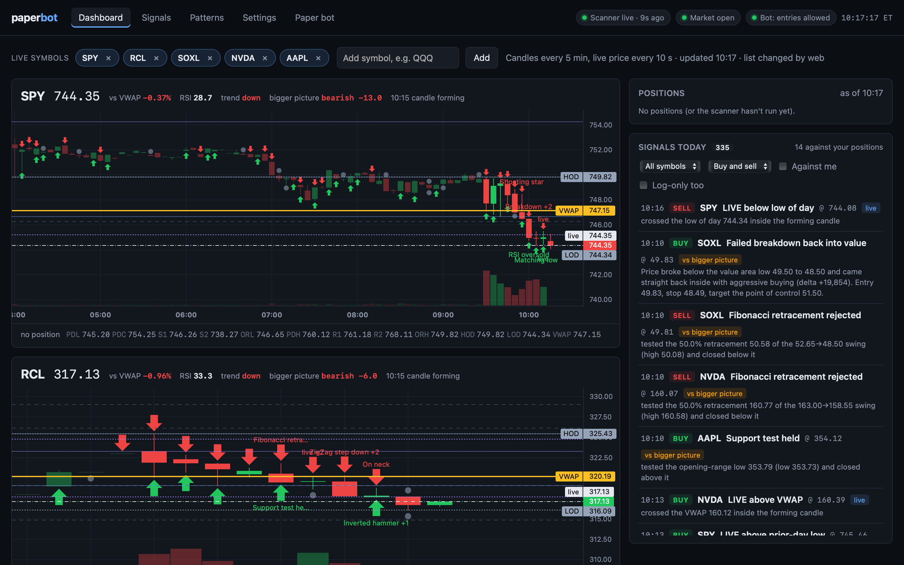
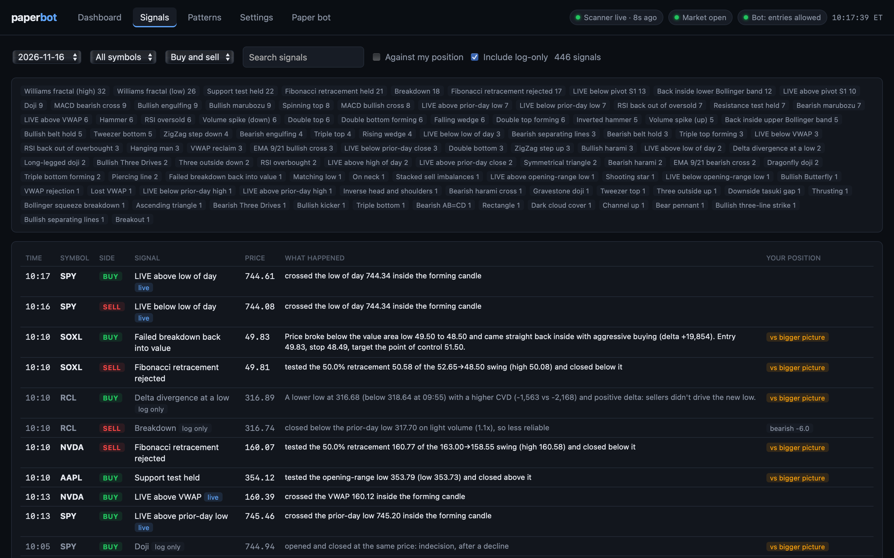
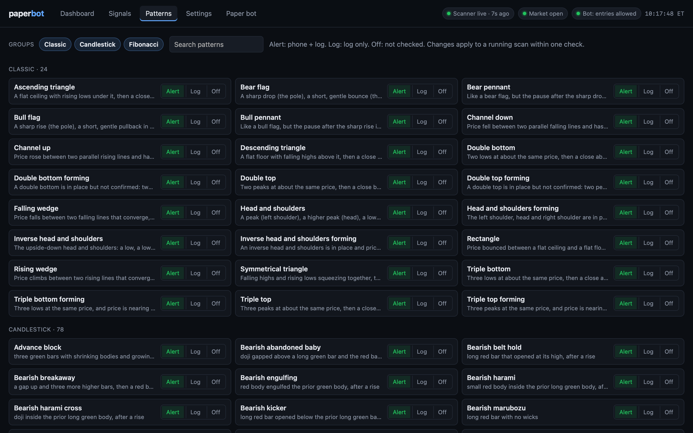
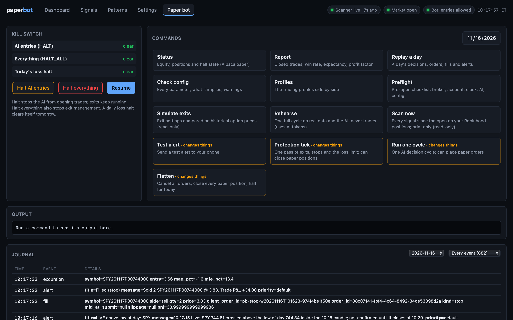

# paperbot

**An AI options-trading agent and a real-time chart-signal scanner, with a live web dashboard.**
Paper trading only: no real money is ever at risk.



*The dashboard during a live session (Nov 16, 2026): every buy (green) and sell (red) signal is
marked on the candle that triggered it, next to VWAP, high and low of day, prior-day and
opening-range levels. Under each chart, the order-flow panel shows every candle's delta (bars) and
the session's cumulative delta (blue line). The feed on the right explains each signal in plain words.*

## Highlights

- **The AI proposes, code decides.** Each cycle is a LangGraph state graph: preflight, protect,
  snapshot, research with tool calls, decide, execute, report. The LLM returns JSON trade
  proposals; plain Python checks each one against hard risk limits, places the orders and runs
  every exit. The prompt never enforces a limit.
- **116 chart patterns, scanned live.** 24 classic (head and shoulders, triangles, flags, wedges,
  double and triple tops and bottoms), 78 candlestick and 14 Fibonacci patterns, plus VWAP, EMA,
  MACD, RSI, Bollinger band and pivot events. Runs on every 5-minute candle, with live price checks
  every 10 seconds.
- **Order flow from the trade tape.** Footprint bars, delta, cumulative delta and volume profile,
  used to spot absorption, stacked imbalances, exhaustion, divergence and failed breakouts
  ([docs/ORDERFLOW.md](docs/ORDERFLOW.md)). Every chart-pattern signal also gets a second
  opinion from the tape: order flow agrees, disagrees or is mixed, and with
  `orderflow.check_mode: filter` a signal the tape disagrees with stays off your phone.
- **QQE Long and QQE Short labels.** The QQE signal (a smoothed RSI crossing its volatility line, with the
  same RSI 14 / smoothing 5 / factor 4.238 settings as TradingView's "QQE signals" script) is drawn on
  every chart as its own labels, separate from the scanner's signals. Display only: never alerted or traded.
- **Context-aware phone alerts.** Each signal is checked against the slower trend and key price
  levels, then pushed to your phone, flagged when it goes against a position you hold.
- **Any LLM, with automatic fallback.** Claude, Grok, Groq, Gemini or OpenRouter. When one model
  hits its rate limit or daily token budget, the next one answers.
- **Built to be trusted.** Kill switches, a daily loss limit, runaway-order protection, a journal
  of every decision, order and fill, and 300 tests that run against a fake broker and scripted AI
  replies.

**Tech:** Python 3.13 · LangGraph · Anthropic and OpenAI-compatible APIs · Alpaca API ·
Starlette · TradingView Lightweight Charts · pytest · macOS launchd

It only trades Alpaca's paper (simulated) account, for short-dated options on SPY, QQQ, AAPL, MSFT
and NVDA. There is no live-trading code path: the broker adapter always builds the paper client,
checks that it points at `paper-api.alpaca.markets`, and refuses live keys (they start with `AK`).
The design follows Autobelay's (see [below](#autobelays-gaps-and-what-this-build-does-instead)).
Nothing here is financial advice, and no signal has a proven edge.

## Screenshots

**Signals.** Every signal of the day: chart patterns, 14 order-flow setups and indicator events.
Each row says what happened and whether it goes with or against your position.



**Patterns.** The full catalog, with each pattern set to alert, log only or off. Changes reach the
running scanner within one check.



**Paper bot.** The control panel for the AI trading agent: kill switches, one-click commands, and
the journal of every decision, order, fill and alert.



## Quick start

```bash
python3.13 -m venv .venv
.venv/bin/pip install -e ".[dev]"
cp .env.example .env        # add Alpaca paper keys, one AI provider key, NTFY_TOPIC
```

Pick the AI with `llm.provider` in `config.yaml` (see [Choosing the AI](#choosing-the-ai)).

1. Install the **ntfy** app on your phone and subscribe to the topic you put in `NTFY_TOPIC`.
   Topics on ntfy.sh are public, so use a long random name (`openssl rand -hex 16`).
2. Send a test alert: `.venv/bin/python -m paperbot test-alert`
3. Run the pre-open checklist: `.venv/bin/python -m paperbot preflight`
4. Rehearse a full cycle on real data, any time (a dry run, never trades): `.venv/bin/python -m paperbot rehearse`
5. Run it for real (paper): `.venv/bin/python -m paperbot run`

Run the tests with `.venv/bin/python -m pytest`. They use a fake broker and scripted AI replies, so they
need no keys or network.

## How it works

Two loops run in one process ([runner.py](paperbot/runner.py)):

| Loop | Every | Uses the AI? | Job |
|---|---|---|---|
| Watcher | 30 s | No | Loss limit, losing streak, stale orders, code exits, broker stops, setup alerts, phone commands |
| Decision cycle | 15 min | Once per cycle | Ask the AI for proposals, then send them through the risk gate |

The decision cycle runs in a worker thread, so the watcher keeps protecting positions while
the AI thinks. Order placement in both loops is serialized by one lock.

### The decision cycle, step by step ([graph.py](paperbot/graph.py))

```
preflight → protect → snapshot → research ⇄ tools
                                    ↓
                                  decide → execute → report
```

Any step can end the cycle early. It then jumps straight to `report`.

1. **preflight.** Checks the kill-switch files, that the market is open, that the time is inside
   09:45–15:45 ET, and (if set) that the account number matches `config.yaml`.
2. **protect.** Runs the same code-only protection pass as the watcher
   ([protect.py](paperbot/protect.py)). If the daily loss limit is hit, it sells everything and
   halts for the day. If any code exit fired, the cycle ends, because the AI's snapshot would
   already be stale.
3. **snapshot.** Pulls account, positions, orders, underlying prices, intraday features
   computed by code from today's 1-minute bars ([features.py](paperbot/features.py)), and 12
   near-the-money contracts per underlying (6 on Groq) ([research.py](paperbot/research.py)). It builds the prompt
   ([prompt.py](paperbot/prompt.py)), which includes the remaining loss budget and the reason
   each position was opened. If no new entries are allowed and nothing is held, the AI isn't
   called.
4. **research ⇄ tools.** The AI gets five read-only tools: bars, stock snapshot, option chain,
   option quotes and news. It can make up to 6 tool calls (2 on Groq). After that the next
   request sets `tool_choice: none`, which forces a final answer. Each provider's request format
   lives in [llm.py](paperbot/llm.py); the graph doesn't know which one it's talking to.
5. **decide.** The answer is validated with Pydantic against the decision schema. A refusal, a
   truncated answer, or JSON that doesn't validate all mean **hold**.
6. **execute.** Re-checks the kill switch, because someone may have halted while the AI was
   thinking. Each proposal then goes to the order funnel.
7. **report.** Writes everything to the journal and sends phone alerts.

### The order funnel ([orders.py](paperbot/orders.py))

This is the only module that places or cancels orders. A test fails if any other module calls
`submit_order`, `cancel_order` or `close_all`.

- It fetches **fresh** broker state and a fresh quote right before each order. Prices from the
  snapshot are never used.
- Every order goes through `RiskGate.check()` ([risk.py](paperbot/risk.py)), which rejects and
  never resizes. The checks are: universe, option-only, qty cap, DTE 2–14, entry cutoff,
  blackout windows, quote no older than 60 s, spread ≤ 12%, limit ≤ ask, one working entry per
  contract, max positions, max $ per position, entries per day, 5-min cooldown between entries,
  no new entries after 3 losing trades in a row, re-entry cooldown, risk to stop ≤ 0.5% of
  equity, remaining daily loss budget, and buying power. Sells can only sell what you hold,
  minus what is already in resting sells.
- Every sell is sent with `position_intent=sell_to_close`, so a sell can never open a short.
- Client order IDs are deterministic per cycle (`pb-entry-20261026T1040-<hash>`), so a retry
  can't fill the same order twice.
- `flatten_all()` is the one path that skips the gate, because it only closes positions.

### The kill switch ([risk.py](paperbot/risk.py))

The kill switch is a set of files in `logs/`, read straight from disk on every tick:

| File | Effect | How to set it |
|---|---|---|
| `HALT` | The AI stops opening trades. Exits and broker stops keep running. | `paperbot halt`, or send `halt` from your phone |
| `HALT_ALL` | Everything stops, exit management included | `paperbot halt --all` |
| `HALT_<date>` | Same as `HALT` for the rest of the day | Set automatically by the loss limit, or `paperbot flatten`, or send `flatten` from your phone |

`paperbot resume` clears `HALT` and `HALT_ALL`. It leaves a daily halt alone.

### Phone alerts and commands ([notify.py](paperbot/notify.py))

You get an alert for every entry and exit, the daily loss limit (urgent priority), order errors,
failed AI calls, and a summary after the close. Set `NTFY_CONTROL_TOPIC` to control the bot
from your phone by publishing one of these words to that topic:

- `halt`: the AI stops opening trades
- `flatten`: close everything and halt for the day
- `status`: reply with equity and positions

Phone commands can only make the bot safer. Resuming, or anything that opens a trade, has to be
done on the machine. Telegram works too (`alerts.provider: telegram`). With Telegram, only
messages from your own chat ID are accepted. An alert that fails to send is logged and never
stops trading.

## Autobelay's gaps and what this build does instead

| Gap in Autobelay | Fix here | Where |
|---|---|---|
| Stops were checked only every 10 min and weren't orders at the broker, so a fast drop could blow past −40%. | Every position gets a real **GTC stop order at Alpaca**, re-checked and resized on every watch tick. Code exits run every **30 s** instead of every 10 min, and keep running while the AI is thinking. | [protect.py](paperbot/protect.py), [watcher.py](paperbot/watcher.py) |
| The 2% daily loss limit was a target, not a ceiling, because it was checked only between cycles. | Checked every 30 s. On top of that, a new entry is allowed only if its worst-case loss (premium × stop %) fits in **what's left of today's loss budget** after the current drawdown and the open positions' distance to their stops. | `RiskGate.remaining_risk_budget` in [risk.py](paperbot/risk.py) |
| Churn guard disabled (`min_hold_minutes: 0`). | Config validation **refuses** values that disable a limit (min hold 0, `close_at_dte ≥ min_dte`, …). Min hold is 20 min, and there's a 30-min re-entry cooldown per underlying. Code exits ignore min hold, so protection is never blocked. | [config.py](paperbot/config.py) |
| New buys were market orders, which cost money on wide spreads. | Entries are **limit orders** at mid + 20% of the half-spread, priced on a fresh quote, never above the ask. Spread is capped at 12%, and unfilled entries are cancelled after 5 min. Exits start as a limit at the bid. If that hasn't filled after 60 s, the next attempt is a market order. | `OrderFunnel.enter/exit` in [orders.py](paperbot/orders.py) |
| Fragile JSON parsing (a regex from the first `[` to the last `]`). | API **structured outputs** with a strict schema, then Pydantic validation. Anything that doesn't validate means hold. | [prompt.py](paperbot/prompt.py), `decide` in [graph.py](paperbot/graph.py) |
| Retry dedupe IDs were per second, so a retry in the next second could double-fill. | IDs are derived from the cycle slot and the order details, so a retry anywhere in the same cycle is rejected by Alpaca. | `client_order_id` in [orders.py](paperbot/orders.py) |

A few other hardening changes:

- **Orphan sells are cancelled.** A stop left behind for a position that's gone could otherwise
  open a short.
- **One instance at a time**, enforced by a lock file.
- **Live keys are refused**, and the trading client's URL is checked at startup.

## Research-driven additions

I researched what works and what fails in AI and intraday trading, including scalping, and
turned it into the questions and fixes below. [docs/RESEARCH.md](docs/RESEARCH.md) has the
evidence and sources. The short version: most day traders and 0DTE option buyers lose money,
published LLM trading results are weak, and the patterns with evidence behind them are small and
eaten by costs. So these changes are about **measuring honestly and limiting damage**. None of
them makes profit likely, and none of this is financial advice.

| Question | What changed |
|---|---|
| Is it making money? | `paperbot report` rebuilds every round-trip trade from broker fills: P&L, win rate, expectancy, profit factor, longest losing streak, and a warning below 30 trades. The daily summary includes the day's trades and AI token use. ([performance.py](paperbot/performance.py)) |
| Can a stale quote cause a bad entry? | Entries are refused on quotes older than `max_quote_age_seconds` (60). |
| What stops a losing streak? | After 3 losing trades in a row, no new entries for the day (with an alert). Entries are spaced at least 5 minutes apart, and each risks at most 0.5% of equity to its stop. |
| Can a poisoned headline steer the AI? | News is stripped of invisible and formatting characters, normalized, capped in length, and labeled untrusted. The prompt says never to follow instructions found in tool output. |
| Does the AI see useful intraday context? | Code computes VWAP, the 15-minute opening range, the first-half-hour return, RSI(14), ATR(14), EMA 9/21 trend and recent relative volume, and puts them in the prompt. |
| Can I get real-time setup alerts? | Every 5 minutes during trading hours the watcher pushes opening-range breaks and strong first-half-hour moves, once per symbol per day. They're information only. |
| Do winners give back gains? | Once a position is up 30%, the broker stop moves to breakeven. It only ever moves up. Optional trailing stop. A replacement stop that fails the risk check now leaves the old stop in place. |
| Can it scalp? | A time stop (`max_hold_minutes`), an end-of-day close (`close_all_at`), and a scalp profile, [config.scalp.yaml](config.scalp.yaml). |
| Does it avoid scheduled events? | Entry blackout windows, starting with the FOMC decision on Wed 2026-10-28, 13:45–15:00 ET. |

### Round 2: more research, more checks

A second pass brought the total to 140 cited sources, and tested exit settings on real option
prices. [docs/RESEARCH.md](docs/RESEARCH.md) has the details (findings 11–28), and
[docs/PARAMETERS.md](docs/PARAMETERS.md) explains every setting and every Alpaca order
parameter.

| Area | What changed |
|---|---|
| Entries | Refused before earnings (MSFT 10-28, AAPL 11-02, NVDA 11-18), outside \|delta\| 0.30–0.70, under 100 open interest, or decaying faster than 10%/day. At most 2 calls (or 2 puts) at once. 10% spread cap. Blackouts for jobs and CPI mornings. |
| Sizing | Assumes a stop-out loses 1.5× the stop distance; the worst simulated stop fills hit ~2×. Past a 1% drawdown, per-trade risk halves. |
| Exits | Positions are closed before an earnings gap. Early-close days shift every cutoff. |
| Safety | Runaway protection: 30 order actions or 5 rejections in 10 minutes trips HALT_ALL. If Alpaca rejects stop orders, code stops take over (with one alert). Refuses to start on accounts below options level 2. Skips stale market data. Slow-tick alerts. Optional dead man's switch (`HEALTHCHECK_URL`). |
| Measuring | Fill alerts with slippage, fill rate, Monte Carlo drawdowns, MAE/MFE, rejection reasons, an edge check (probabilistic Sharpe and the trades needed to be 95% sure), `paperbot replay`. |
| AI input | A compact candidate table (21% fewer tokens) with decay and the max size each limit allows, plus gap, prior-day and implied-move context. |
| Tools | `check-config` (every parameter, what it implies, warnings), `simulate-exits` (exit settings on real historical option bars), `preflight` (pre-open checklist), `eval-prompts` (AI consistency and agreement). |

### Measuring it

```bash
.venv/bin/python -m paperbot report --days 30
```

```bash
.venv/bin/python -m paperbot check-config --broker
```

```bash
.venv/bin/python -m paperbot simulate-exits --days 60 --entry-time 10:30,13:00
```

```bash
.venv/bin/python -m paperbot replay --date 2026-10-26
```

Before the open, run the checklist. It checks the broker, account, clock skew, the AI, the config,
the kill switch, and whether another instance is running:

```bash
.venv/bin/python -m paperbot preflight
```

To check whether the AI's decisions are repeatable, or to compare a prompt or model change
against what it decided before, replay saved prompts. Each replay is a real AI call:

```bash
.venv/bin/python -m paperbot eval-prompts --limit 10 --repeat 2
```

### Switching strategy: profiles

Pick a strategy when you start paperbot, and compare them side by side:

```bash
.venv/bin/python -m paperbot profiles
```

```bash
caffeinate -i .venv/bin/python -m paperbot --profile aggressive run
```

| Profile | File | In short |
|---|---|---|
| `default` | [config.yaml](config.yaml) | 2–14 DTE, AI every 15 min, holds hours to days |
| `scalp` | [config.scalp.yaml](config.scalp.yaml) | 1–3 DTE, AI every 5 min, 45-min time stop, flat by 15:50 |
| `aggressive` | [config.aggressive.yaml](config.aggressive.yaml) | 0–1 DTE SPY/QQQ, AI every 5 min plus an extra cycle on every setup alert, 10 s checks, −15%/+20% exits, breakeven and trailing, 15-min time stop, flat by 15:15, up to 20 entries a day |

The aggressive profile is faster and more frequent, not bigger: per-trade risk (0.5%), the 2% daily
loss limit, the losing-streak breaker and runaway protection stay on. Read its file header first. On
real 0–1 DTE SPY data with no-edge entries, its exits averaged −2.1% per trade, with losses held to
about −17%. It needs the AI to win roughly 43–52% of trades just to break even. On Groq's free tier,
the daily token budget stops its AI cycles early in the afternoon; exits keep running.

Switching applies the new profile's exits to positions you already hold. For example, the
aggressive 15-minute time stop would close an older position at the first check, so switch when
you're flat. Only one profile runs at a time: they share `logs/` and the kill switch.

### The scalp profile

[config.scalp.yaml](config.scalp.yaml) trades only SPY and QQQ, 1–3 days to expiration. It has
a 6% spread cap, a −20% stop, a +30% target, breakeven after +12%, a trailing stop, a 45-minute
time stop, and closes everything at 15:50. Run it with `--config config.scalp.yaml` instead of
the default profile, not alongside it. It consults the AI every 5 minutes, which Groq's free
tier can't sustain (see the file's header). This is "scalping" in minutes, not seconds: an AI in
the loop can't react second by second, and on free indicative quotes nothing can.

## Chart signals on your Robinhood positions

`paperbot scan` reads your positions in a real Robinhood account and pushes buy and sell signals
to your phone. It is **read-only**: [robinhood.py](paperbot/robinhood.py) can call only
`get_accounts`, `get_equity_positions` and `get_equity_historicals`. Any other tool name is
refused in code before a request is sent, and a test checks the list. It never trades,
on Robinhood or on Alpaca, and these are technical signals, not advice.

Setup, once:

1. In claude.ai, open Settings > Connectors > Robinhood and copy the MCP server URL into `.env`
   as `ROBINHOOD_MCP_URL`.
2. Sign in: `.venv/bin/python -m paperbot robinhood-login`. A browser window opens for
   Robinhood's sign-in, then your accounts are listed (masked). The tokens are kept in
   `~/.config/paperbot/robinhood-oauth.json` (mode 600).
3. Put the account to scan in `.env` as `ROBINHOOD_ACCOUNT_NUMBER`.

Then:

```bash
.venv/bin/python -m paperbot scan --no-alerts
```

```bash
caffeinate -i .venv/bin/python -m paperbot scan --live
```

`scan` prints a table (position, last price, P&L, RSI, distance from VWAP, trend) and every new
signal. `--catch-up` checks every bar since the open, not just the last one, and alerts only signals not
already sent today; it's for scans hours apart. A print-only run (`--no-alerts`) never marks a signal as
sent.

To scan every 2 hours without keeping a terminal open, a launchd job
(`~/Library/LaunchAgents/com.paperbot.scan.plist`) runs `paperbot scan --catch-up` on weekdays at
11:32, 13:32, 15:32 and 16:07, in the Mac's time zone (set it to Eastern): 2 minutes after a bar closes,
so it never races the live SPY scan below. If the Mac is asleep, launchd runs the missed scan when it
wakes. Output goes to `logs/scan.log`. To stop it:

```bash
launchctl bootout gui/$(id -u)/com.paperbot.scan
```

A second job (`~/Library/LaunchAgents/com.paperbot.spy-live.plist`) runs `paperbot scan --live` all the
time: it starts at login, restarts if it crashes, and sleeps between the sessions it scans. Its log is
`~/Library/Logs/paperbot/spy-live.log`, outside Downloads, because launchd can't open a log file inside
Downloads that another app created. To watch it, and to stop it:

```bash
tail -f ~/Library/Logs/paperbot/spy-live.log
```

```bash
launchctl bootout gui/$(id -u)/com.paperbot.spy-live
```

`--live` scans a few seconds after each 5-minute bar closes, 4:00–20:00 ET on weekdays, and sends alerts
through your ntfy or Telegram setup. Everything it does comes from the `scan:` block in `config.yaml`:

- `sessions: [pre, regular, post]` is when it runs: pre-market (4:00–9:30), regular hours (9:30–16:00)
  and after hours (16:00–20:00). The last candle of a session is scanned when it closes. Pre-market and
  after-hours candles count for indicators and patterns, and their volume is compared with other
  extended-hours candles. VWAP, the opening range, the high and low of day and the prior day's levels
  always come from regular hours. Robinhood's overnight session (20:00–4:00) isn't scanned.
- `live_symbols: [SPY]` is what it scans (empty: everything you hold plus the watchlist).
- `tick_seconds: 10` also checks the live price every 10 seconds between candle closes (read-only
  `get_equity_quotes` and `get_option_quotes`); `live_positions_seconds: 60` re-reads positions at most
  once a minute in between. When the price crosses VWAP, the high or low of day, the opening range, the
  prior day's high, low or close, or a pivot inside the forming candle, the phone gets a `LIVE` alert at once,
  marked "not confirmed until it closes"; the same cross waits `tick_cooldown_minutes` (10) to alert again.
  Each check also logs a status line with the price and your options' mark and P&L. That line isn't pushed:
  a push every 10 seconds would be 2,340 a day, far past ntfy.sh's limit of 250.

The symbol list changes while the scan runs, with no restart, from the command line or from anything that
calls `paperbot.livelist.LiveList` (an AI tool, a web page):

```bash
.venv/bin/python -m paperbot live-symbols add QQQ NVDA --by ai
```

`live-symbols list`, `remove`, `set` and `reset` (back to `config.yaml`) work the same way, and `--json`
prints the result for a program. The list is kept in `logs/live_symbols.json`, written atomically; the scan
rereads it before every check and scans a new symbol at once. `--only SPY` and `--tick 30` on the command
line override the config for one run. `--symbols SPY,QQQ` adds symbols to a single scan; `scan.watchlist`
adds them to every scan.

Option positions count too: a long call or short put is bullish, a long put or short call bearish, so
an alert on SPY says "You hold 3 SPY 765 puts expiring 10/27 (avg 0.27): this signal goes against it."
Scans running side by side reread the journal after each fetch, so a signal one of them sent isn't sent
again by the other. It doesn't need Alpaca keys or the AI, and it
can run beside `paperbot run`.

The signals ([patterns.py](paperbot/patterns.py)), on completed 5-minute bars only:

| Group | Signals |
|---|---|
| VWAP | reclaim, loss, bounce off it, rejection at it (the low or high within `vwap_touch_atr`, 0.1 ATR, of VWAP) |
| RSI(14) | into oversold (< 30) or overbought (> 70), and back out |
| Trend | EMA 9/21 cross, MACD (12, 26, 9) signal-line cross |
| Bollinger (20, 2) | close back inside a band; a squeeze that breaks out |
| Support / resistance | a test that held, and breakouts and breakdowns with a volume check. Levels: prior-day high, low and close, classic pivots (R1/R2, S1/S2), the 15-minute opening range, and the high and low of day |
| Candles | bullish or bearish engulfing, hammer, shooting star, only at a support or resistance (VWAP included) |
| Volume | a bar at 3x or more of the 20-bar average |
| Daily | golden or death cross (50/200-day), new 52-week high or low |
| Classic chart patterns | double top / bottom, triple top / bottom, head and shoulders and inverse (through the neckline); ascending, descending and symmetrical triangles, rising and falling wedges, channels up and down, rectangles (through either trendline); bull and bear flags and pennants (a 3-ATR pole, a pause, a break in the pole's direction). Drawn from swing highs and lows of 1 ATR or more over the last 120 bars; weak on light volume |
| Candlestick patterns | every pattern on thinkorswim's Candlestick tab, bullish and bearish where both exist: abandoned baby, advance block, belt hold, breakaway, concealing baby swallow, dark cloud cover, deliberation, doji, downside / upside gap three methods, downside / upside tasuki gap, engulfing, evening / morning star and doji star, falling / rising three methods, hammer, hanging man, harami, harami cross, high / low price gapping play, homing pigeon, identical three crows, in neck, inverted hammer, kicker, ladder bottom, long-legged doji, marubozu, mat hold, matching low, meeting lines, on neck, piercing line, separating lines, shooting star, side-by-side white lines, stick sandwich, three black crows, three inside / outside up and down, three-line strike, three stars in the south, three white soldiers, thrusting, tri-star, two crows, unique three river bottom, upside gap two crows, Williams fractal, ZigZag step; plus dragonfly and gravestone doji, spinning top and tweezers. Reversals need a move into them (`candle_trend_atr`) |
| Fibonacci | AB=CD, Gartley, Bat, Butterfly, Crab and Three Drives (bullish and bearish), when price turns at D; the first test that held at the 38.2 / 50 / 61.8 / 78.6% retracement of the latest swing of 3 ATRs or more |

`paperbot patterns` lists all of them (110 kinds) with their group and what the scan does with each:
alert, log only or off. `scan.pattern_groups` turns a whole group (classic, candlestick, fibonacci) on or off,
`scan.disabled_patterns` drops single patterns, and `scan.log_only_patterns` keeps them in the log without a
phone alert; by default doji, long-legged doji, spinning tops and Williams fractals, which on 5-minute bars
come every few minutes.

Every alert says whether the signal goes **with or against** your position. A buy signal on a
short or a sell signal on a long is sent at high priority. Noise control: a cross must close
0.2 ATR past the line, MACD and EMA crosses need a real swing first, the opening gap bar reports
only level breaks, each signal family has a 30-minute cooldown on each symbol, and each scan sends
one alert per symbol. On a choppy real NVDA session (2026-10-26) that came to 33 alerts, down
from 61 before the filters. Raise `scan.cooldown_minutes` for fewer.

### The bigger picture: when the 5-minute signal isn't the whole story

A 5-minute signal sees a few candles. Before it's alerted, [context.py](paperbot/context.py) checks it
against the last `scan.context_minutes` (3 hours) of the same chart and against 15-minute candles
(`scan.context_bar_minutes`). Each piece of evidence gets a side and a weight:

| Weight | Evidence |
|---|---|
| 3 | A chart pattern that broke in the window and still holds (price hasn't closed back through its line), on the 5-minute or the 15-minute chart: head and shoulders and inverse, double and triple tops and bottoms, triangles, wedges, channels, rectangles, flags, pennants. A "break" on the opening bar is the overnight gap and doesn't count |
| 2 | A head and shoulders (or inverse) or a triple top or bottom **still forming**: the last shoulder is in place, the neckline hasn't broken, price is within 3 ATRs of it. And the swing structure: lower highs and lower lows, or higher highs and higher lows |
| 1 | A double top or bottom still forming; the 15-minute EMA 9/21 trend and MACD; 15-minute RSI past 70 or 30 (the risk is the other way); price above or below VWAP |

The weights add up to a score; at `scan.context_threshold` (3) or more either way, the picture is bullish or
bearish. A signal **conflicts** when any factor of weight 2 or more points the other way, or the score does.
With `scan.context_mode: warn` the alert's title says "against the bigger picture", it goes out at high
priority, and it ends with the reasons, for example (from a drawn chart in the tests):

> BUY T 13:35 Support test held at 99.60 ... WARNING: Bigger picture (last 3h) is bearish, score -6: head and
> shoulders on the 5-minute chart broke down at 13:00 through 101.20, still below it; lower highs (106.05 then
> 103.15) and lower lows (101.05 then 98.45); price below VWAP 101.64. This buy signal goes against it.

`suppress` logs conflicting signals without pushing them; `off` turns the check off. Every scan prints the
bigger picture per symbol, the journal records `context`, `context_score` and `conflict` on each signal, and
the web page shows them.

Tops and bottoms also warn **before** they break: when price first closes within `scan.forming_near_atr` (0.5)
ATRs of the neckline of a head and shoulders, triple or double top or bottom that's still forming, the scan
alerts "Head and shoulders forming" (or the others), with the neckline that would confirm it. On the real
SPY session of 2026-10-27 the check flagged the two morning sell signals (10:35, 11:20) as going against a
15-minute uptrend; SPY went on to 771.

## Order flow

[orderflow.py](paperbot/orderflow.py) reads the trade tape. It covers absorption and its confirmation (Bookmap), footprint imbalances and exhaustion (Axia Futures), and Fabio Valentini's trend-continuation and failed-breakout models. The signals can go into:
- the AI's prompt
- the bot's setup alerts
- the scanner's charts, with tooltips
- a panel under each dashboard chart: every candle's delta (shares bought at the offer minus shares
  sold at the bid) as green or red bars, and the session's cumulative delta (CVD) as a line
- a check on every chart-pattern signal (breakouts, support tests, head and shoulders, candlesticks
  and the rest): **order flow agrees** when the signal candle's delta and the CVD over the last 3
  candles point the signal's way, **disagrees** when they point against it, **mixed** otherwise.
  It shows as a tag in the signal feed and tooltip, and in the phone alert's title and text
  (`orderflow.check_signals`, `orderflow.check_bars`). LIVE level crosses get the same check from
  the forming candle's delta so far. With `orderflow.check_mode: filter` (this repo's setting), a
  signal or live cross that order flow disagrees with becomes log only: it stays on the page, grey
  on the chart, and isn't pushed to the phone. `tag` only shows the verdict
- the scanner's bigger picture: a CVD clearly rising or falling over the last 3 hours counts as a
  weight-1 factor (`orderflow.in_context`)

It is **off in the code's defaults**; this repo's `config.yaml` turns it on for practice. On Alpaca's free IEX feed, the signals didn't match the market's real order flow: 1 of 20 setups in a week matched the full tape. The live version needs the paid full-market feed (`orderflow.feed: sip`).

To study any past session for free:

```bash
.venv/bin/python -m paperbot orderflow SPY,QQQ --date 2026-11-13 --days 5 --detail
```

[docs/ORDERFLOW.md](docs/ORDERFLOW.md) has the rules, the IEX vs full-tape comparison and a week of results.

## Web page

```bash
.venv/bin/python -m paperbot web --open
```

A local page at http://127.0.0.1:8765/ for everything the command line does:

- **Dashboard**: each live symbol's 5-minute candles with its signals marked (labels on the latest few) and
  its levels drawn (VWAP, high and low of day, opening range, prior-day high, low and close, pivots), the live
  price, RSI, trend and the scanner's bigger-picture reading; your positions with live P&L; today's signals as
  they come, filtered by symbol, side, against your position, and log-only. Add or remove live symbols at the
  top; the running scan follows within one check.
- **Signals**: any day's signals from the journal, searchable, with counts per signal.
- **Patterns**: every pattern by group (classic, candlestick, Fibonacci), each set to alert, log only or off.
- **Settings**: every scanner setting with its description and its config.yaml value. Changes go to
  `logs/settings.json` over config.yaml, which stays as you wrote it, and a running scan applies them within
  one check. The full configuration is shown read-only below.
- **Paper bot**: the kill switch (halt AI entries, halt everything, resume), the bot's commands (status,
  report, replay, check-config, profiles, preflight, simulate-exits, rehearse, a print-only scan, test alert,
  protection tick, one cycle, flatten; the last four ask first), their output, and the day's journal.

It reads what the scanner and the bot write (`logs/scan_state.json`, the journal, the kill-switch files)
and changes things only through the same files and commands, so the page, the command line and an AI tool
see one state. The live scanner must be running for the dashboard to move (the launchd job above). The page
is for this computer only: it listens on 127.0.0.1, refuses other host names, and every change needs a token
that's printed into the page when the server starts. The chart library comes from unpkg.com.

A launchd job (`~/Library/LaunchAgents/com.paperbot.web.plist`) keeps the page up: it starts at login and
restarts if it stops, so http://127.0.0.1:8765/ is always there. Its log is
`~/Library/Logs/paperbot/web.log`. After changing the server's code, restart it; to stop it:

```bash
launchctl kickstart -k gui/$(id -u)/com.paperbot.web
```

```bash
launchctl bootout gui/$(id -u)/com.paperbot.web
```

## Choosing the AI

Set `llm.provider` in `config.yaml` and put that provider's key in `.env`. Everything else (the
risk gate, order funnel, stops, exits, kill switch and alerts) is the same for all three.

| `llm.provider` | Key in `.env` | Default model | JSON answer | Notes |
|---|---|---|---|---|
| `anthropic` | `ANTHROPIC_API_KEY` | `claude-opus-5-5` | Enforced by the API alongside tools | Server-side refusal fallback is on (`fallbacks: "default"`): a falsely flagged request retries on another model |
| `xai` | `XAI_API_KEY` | `grok-4.7` | Enforced by the API alongside tools (Grok 4 models) | Paid; new accounts may get promotional credits |
| `groq` | `GROQ_API_KEY` | `openai/gpt-oss-120b` | Asked for in the prompt. If the answer doesn't validate, one extra tools-free call converts it to the schema | Free tier |

Groq can't combine structured outputs with tools, which is why its answers get the reformat
step. The reformat call is told to keep exactly the proposals the answer states, and its
output still goes through the risk gate like any other proposal.

**Groq's free tier** has a per-minute token limit (around 8,000; whether the requested
`max_tokens` counts toward it isn't documented clearly, so the config keeps it small) and a daily limit (about 200,000 tokens for this model by one account;
check yours at console.groq.com/settings/limits). The `groq` block in `config.yaml` is sized for
it: 6 candidates per underlying instead of 12, 2 tool calls instead of 6, and `max_tokens: 2000`.
A real full-size call measured 4,391 prompt tokens. At a 15-minute interval that's about 24
cycles and roughly 110–160K tokens a day. The daily summary shows the actual count. A call that
hits a rate limit is retried briefly by the SDK; if it still fails, that cycle holds (no trade)
and you get an alert.

**Fallbacks.** `llm.fallbacks` lists models to switch to, in order, when one runs out. A model runs out when:
- today's tokens on it reach its `daily_token_budget`, or
- the provider rate-limits it. A daily quota rests it until midnight; a per-minute limit rests it 2 minutes.

How a switch works:
- If the first AI call of a cycle is rate limited, the next model answers that call at once.
- Later in a cycle the bot holds instead, because the conversation already holds one model's replies.
- You get one "AI fallback" alert per model per day.

Groq counts each model's free quota separately, so every profile falls back to `openai/gpt-oss-20b`, then `qwen/qwen3.8-27b`, on the same key. That is about three times the free daily tokens. All three passed a full rehearsal cycle on the real prompt.

Two providers outside Groq are ready to uncomment in the config once their key is in `.env` (a fallback without its key is skipped):
- `gemini`: the Flash models are free with a Google AI Studio key. On the free tier, Google may use the prompts to improve its products.
- `openrouter`: `:free` models are capped at 50 requests a day.

xAI's Grok API no longer has a free tier.

## Logs

`logs/YYYY-MM-DD.jsonl` has one JSON object per event: the prompt, every AI turn (with token
usage), every tool call, the decision, and every order, rejection, cancel and alert. That's
enough to replay any decision.

```bash
jq -c 'select(.event=="order_rejected") | {symbol, why}' logs/2026-10-26.jsonl
```

## Running it unattended

Run `paperbot run` under something that restarts it if it dies, such as launchd on macOS or
systemd on Linux. You can also use `tmux` while you're trying it out. If the process dies, the
GTC stop orders at Alpaca still protect open positions. Take-profit, the expiry close and the
loss limit don't run until it's back.

On macOS, one script sets up all three as launchd jobs: the web page, the live scanner and the paper
bot. They start at login, keep running when no terminal is open, and come back if they stop. It needs no
admin rights, and it replaces any older copies of the same jobs:

```bash
deploy/launchd/install.sh aggressive
```

| Job | Runs | Restarts | Log in `~/Library/Logs/paperbot/` |
|---|---|---|---|
| `com.paperbot.web` | `paperbot web` | always | `web.log` |
| `com.paperbot.spy-live` | `caffeinate -i paperbot scan --live` | after a failure | `spy-live.log` |
| `com.paperbot.bot` | `caffeinate -i paperbot --profile aggressive run` | after a failure | `bot.log` |

Pass `default` or `scalp` instead of `aggressive` to change the bot's profile. Stop the terminal copies
first: a second bot can't take the lock and keeps retrying every minute. After changing the code, restart a
job; to remove all three:

```bash
launchctl kickstart -k gui/$(id -u)/com.paperbot.bot
```

```bash
deploy/launchd/install.sh --uninstall
```

## What isn't verified yet

- **No order has been placed in market hours yet.** The tests drive the full graph with a fake
  broker and scripted AI replies, and a randomized test checks the risk gate against every limit.
  Against the real services, all of this ran read-only: Alpaca account, positions, quotes,
  greeks, open interest, calendar and historical bars; a full `paperbot rehearse` cycle with
  Groq; and Groq's tool-call round trip. The first real orders will be Monday's.
- **Paper fills are not live fills.** Alpaca's paper engine fills buys at the ask and sells at
  the bid, and free accounts get indicative option quotes. `paperbot report` shows the fill rate
  and slippage you actually get.
- **Stops can fill past their price.** Sizing pads the stop by 1.5×, but a gap can still lose
  more than that; the worst simulated fills reached about 2× the stop.
- **The exit settings were checked on no-edge entries.** `simulate-exits` shows how exits
  interact with decay and costs, not whether the AI's picks make money. Only live paper results
  over 30+ trades can show that, and `paperbot report` includes an edge check for it.
- **Cost.** About 22 AI cycles a day at the 15-minute default, each with up to 3 Groq calls.
  `groq.daily_token_budget` stops AI cycles for the day before the free tier runs out. Token use
  per turn is in the journal and in the daily summary.
